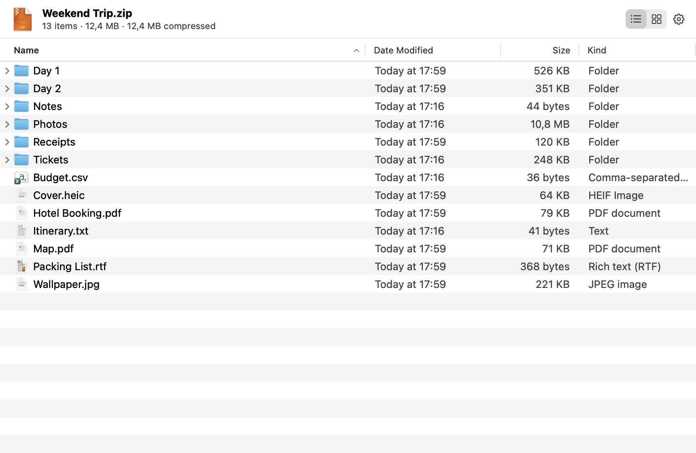
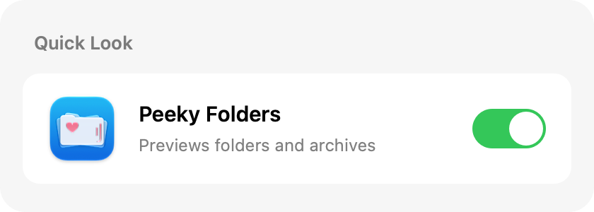

<p align="center">
  
</p>

<h1 align="center">Peeky Folders</h1>

<p align="center"><b>Press Space on a folder, archive, disk image, installer or app in Finder and see what's inside.</b></p>

<p align="center">
  
</p>

> [!NOTE]
> Vibe coded with [Claude Code](https://claude.com/claude-code), with me directing and testing.

<table>
  <tr>
    <td width="50%"></td>
    <td width="50%"></td>
  </tr>
  <tr>
    <td align="center">Folders, with sizes</td>
    <td align="center">Archives, without unpacking</td>
  </tr>
</table>

## Features

- Quick Look for **folders and archives**: zip, tar, gz, 7z, rar, xz, bz2, jar and more
- **Disk images** (.dmg): see the files inside without mounting (HFS+ and APFS)
- **Installer packages** (.pkg): every file it would install, whether it runs install scripts, and who signed it
- **Apps**: browse inside a bundle, with version, architectures and signer
- **List and icon views** with thumbnails, sizes, dates and kinds
- **Folder sizes** calculated in the background
- **Browse into subfolders**, copy items or their paths
- **Update check** against GitHub releases (once a day, can be turned off in the app menu)

## Install

Requires macOS 13 or later (Apple silicon or Intel).

1. Download **PeekyFolders-x.y.zip** from the [latest release](https://github.com/kaichn/peeky-folders/releases/latest)
   and move **Peeky Folders.app** to Applications.
2. Open it. The app isn't notarized, so macOS blocks it the first time: go to
   System Settings → Privacy & Security and click **Open Anyway**
   (or run `xattr -dr com.apple.quarantine "/Applications/Peeky Folders.app"`).

<table>
  <tr>
    <td width="33%" valign="top"><b>3.</b> The welcome window walks you through setup.<br><br></td>
    <td width="33%" valign="top"><b>4.</b> Turn on <b>Peeky Folders</b> in System Settings → General → Login Items &amp; Extensions → Quick Look.<br><br></td>
    <td width="33%" valign="top"><b>5.</b> Select a folder or archive in Finder and press <b>Space</b>.<br><br></td>
  </tr>
</table>

## Build from source

Needs Xcode 26 or later.

```bash
git clone https://github.com/kaichn/peeky-folders.git
cd peeky-folders
./build.sh install
```

## Roadmap

Ideas for upcoming versions, roughly in order. Suggestions are welcome in
[Issues](https://github.com/kaichn/peeky-folders/issues).

**Understand a folder at a glance**
- [ ] Size bars: each row shows its share of the folder
- [ ] Summary line, e.g. "412 files · 72% images · 20% video"
- [ ] Project folders: show the README and git branch/status above the list
- [ ] Highlight recently changed items

**Archives and disk images**
- [ ] Preview a file inside an archive without unpacking it
- [ ] Drag files out of an archive
- [ ] Archive health: compression ratio, encrypted entries, unusually large contents
- [ ] Sparse images (`.sparseimage`, `.sparsebundle`) and old ADC-compressed disk images

**Everyday helpers**
- [ ] Copy a folder listing as a text or Markdown tree
- [ ] Ignore folders like `node_modules` when calculating sizes
- [ ] Find duplicate files

**App**
- [ ] Settings window
- [ ] German translation

## License

[MIT](LICENSE) © 2026 Carl Chen. If Peeky Folders is useful to you, you can [buy me a coffee](https://buymeacoffee.com/kaichn) ☕
