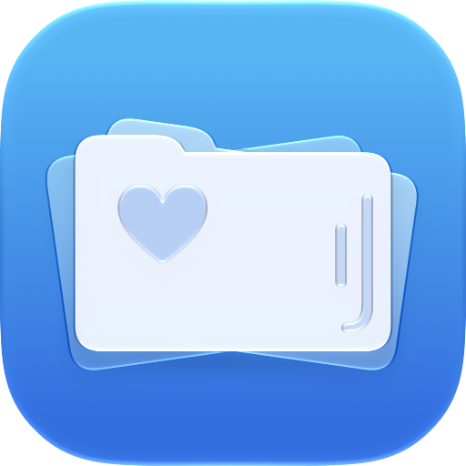
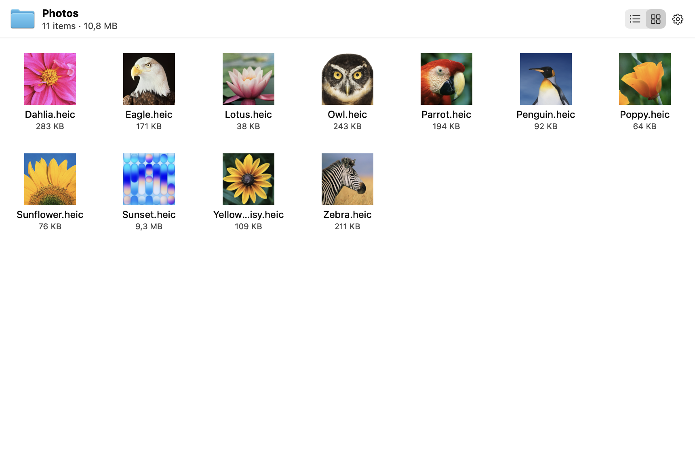
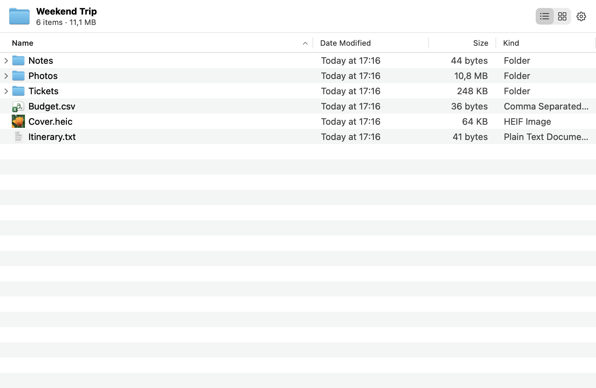
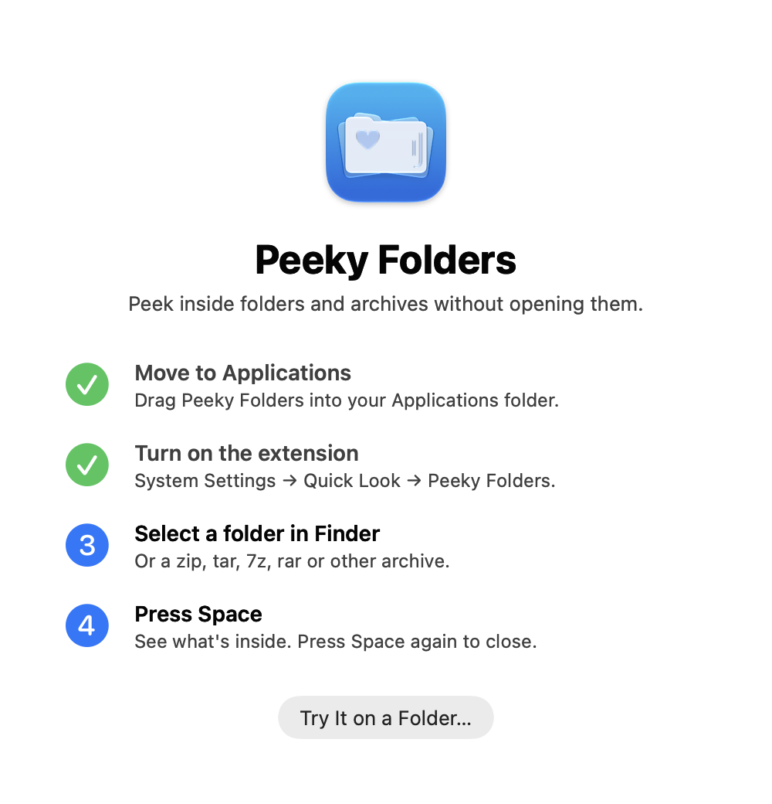

<p align="center">
  
</p>

<h1 align="center">Peeky Folders</h1>

<p align="center"><b>Press Space on a folder or archive in Finder and see what's inside.</b></p>

> [!NOTE]
> This app was vibe coded: written with an AI coding assistant ([Claude Code](https://claude.com/claude-code)),
> with me directing, testing and using it day to day.

Peeky Folders is a Quick Look extension for macOS. Select a folder, a zip or almost any other
archive in Finder, press **Space**, and you get a proper file browser instead of a big generic
icon. It shows names, sizes, dates, kinds and thumbnails, all without opening or unpacking anything.

<p align="center">
  
</p>

## Screenshots

<table>
  <tr>
    <td width="50%"></td>
    <td width="50%"></td>
  </tr>
  <tr>
    <td align="center"><b>List view</b>: sizes, dates and kinds, with folder sizes</td>
    <td align="center"><b>Setup</b>: four steps, ticked off as you go</td>
  </tr>
</table>

<sub>Screenshots use a demo folder made from macOS's built-in sample pictures.</sub>

## Features

- **Folders and archives:** zip, tar, gz, tgz, bz2, xz, 7z, rar, cpio, xar, and .jar (read as zip),
  through the system's libarchive. A single compressed file (`notes.txt.gz`) shows the file inside
  and its uncompressed size.
- **List view** with Name, Date Modified, Date Created, Size, Kind and Items columns.
  Right-click the header to show or hide columns.
- **Icon view** with sizes from 48 to 192 px and lazy-loaded thumbnails for images, SVG, PDF, EPS and video.
- **Fast folder sizes:** subfolders are sized in the background, three at a time, and the work
  stops as soon as you move on.
- **Browse inside:** expand subfolders with the disclosure triangle, or double-click to go in and use ‹ to go back.
- **Copy, Copy Path, Copy Name, Open, Show in Finder** from the right-click menu, and ⌘C.
- **Fixes garbled archive names:** filenames from old Windows or Japanese/Chinese/Korean zips
  are repaired (CP437 → UTF-8, Shift-JIS, GBK, Big5 or EUC-KR).
- **Options** in the ⚙︎ menu: folders on top, text size, preview window size, and an archive size limit.
- **Standalone browser:** open the app and use **File → Open…**, or drop a folder or archive on its icon.

## Requirements

- macOS 13 Ventura or later (the icon uses the new Liquid Glass format on macOS 26 and falls back on older systems)
- Xcode 26 or later to build: `actool` compiles the icon

## Build and install

```bash
git clone https://github.com/kaichn/peeky-folders.git
cd peeky-folders
./build.sh
cp -R "build/Peeky Folders.app" ~/Applications/
open ~/Applications/"Peeky Folders.app"
```

The welcome window walks you through the rest:

1. **Move to Applications.** The extension only loads from an Applications folder.
2. **Turn on the extension:** System Settings → General → Login Items & Extensions → Quick Look →
   Peeky Folders. Or run `pluginkit -e use -i com.charl.PeekyFolders.Preview`.
3. **Select a folder or archive in Finder.**
4. **Press Space.**

The build is ad-hoc signed, so it runs on the Mac that built it. I don't have a Developer ID, so
there's no notarized download.

## How it works

```
Sources/Shared/      BrowserView (the UI), Entry, FolderLoader, ArchiveReader, Settings
Sources/Extension/   PreviewViewController: the Quick Look entry point
Sources/App/         main.swift: host app, welcome window, About panel
Resources/           Info.plists, extension entitlements, AppIcon.icon (Icon Composer)
scripts/             make-icon-layers.py: generates the icon's layers
```

There's no Xcode project. `build.sh` compiles the app and the extension with `swiftc`, links the
system libarchive, compiles the icon with `actool`, and signs everything ad hoc.

The icon is an Icon Composer file. Open `Resources/AppIcon.icon` in Icon Composer to tweak it, or
change `scripts/make-icon-layers.py` and run it again.

For testing without Screen Recording permission, the app can render itself to a PNG:

```bash
PeekyFolders --snapshot <folder-or-archive> out.png [list|icons]
PeekyFolders --welcome-snapshot out.png
```

## Limitations

- Finder keeps keyboard shortcuts inside a Quick Look panel for itself, so pressing Space on an item
  *inside* the preview does nothing.
- The extension is sandboxed with a read-only exception for `/`, so it can size subfolders. An App
  Store build would need another approach.
- The preview keeps its settings in the extension's own sandbox. The app's browser windows keep
  separate ones.
- There's no "ignored folders" setting yet.

## Credits

Inspired by [Folder Preview](https://apps.apple.com/app/folder-preview/id6698876601) by Anybox.
Peeky Folders was written from that app's description only; no code or assets were taken from it.

## License

[MIT](LICENSE) © 2026 Carl Chen
